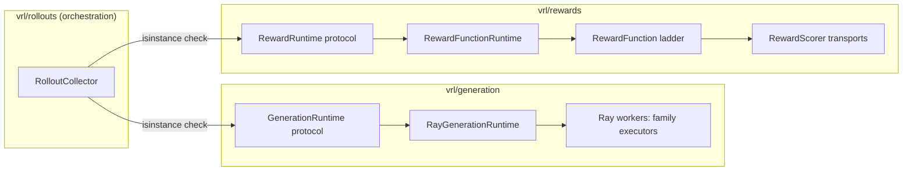
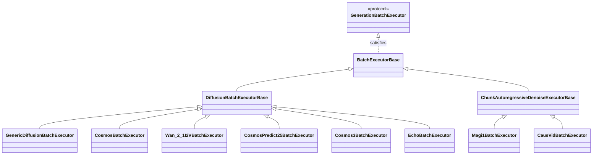
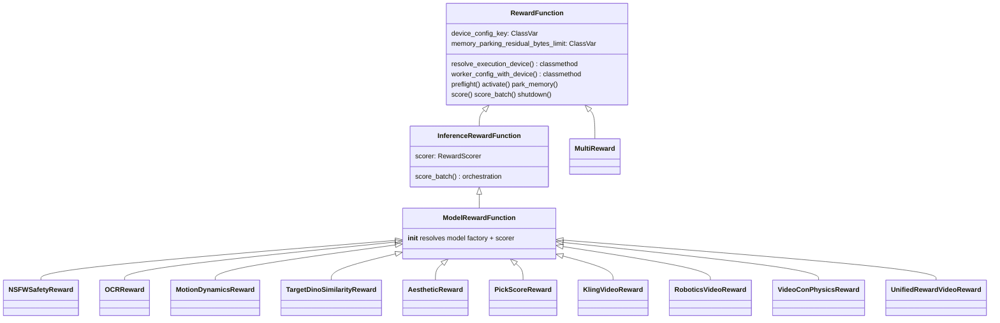

# VRL Engine Architecture — Class Reference

The core engine is **two inference engines with one shape**: generation
(vrl/generation) produces samples, reward (vrl/rewards) scores them, and
vrl/rollouts orchestrates the loop without importing either implementation.
Both engines expose the same lifecycle to their consumer —
`activate → work → offload/park → shutdown`, with reward adding a
`preflight` before launch — and both are
consumed only through runtime-checkable protocols, so orchestration code
never sees Ray, torch, or HTTP.

---

## 1. Shared foundations

| Class | Where | Role |
|---|---|---|
| `TerminalRuntimeError(RuntimeError)` | `vrl/runtime_errors.py` | Root of all "the fleet is dead, stop retrying" failures. |
| `RuntimePhase`, `RuntimeLifecycle`, `RuntimeLifecycleError` | `vrl/utils/lifecycle.py` | Owner-labeled lifecycle FSM. Both engine runtimes drive their phase transitions through it, which is what makes the two lifecycles provably identical. |
| `OperationDeadline`, `OperationTimeout(TerminalRuntimeError)` | `vrl/utils/deadline.py` | Bounded-wait primitive; expiry is terminal by design. |
| `RayCallDeadline(OperationDeadline)`, `RayOperationTimeout(OperationTimeout)`, `RayOperationCancelled(TerminalRuntimeError)` | `vrl/ray/operation_deadline.py` | The same deadline vocabulary specialized for Ray calls. |
| `CumemPool` | `vrl/models/parking.py` | Tagged CUDA allocation pool: build model state inside it, later park physical pages to pinned host RAM and verify the residual (`validate_parking_residual`, `CUDA_RUNTIME_RESIDUAL_BYTES_LIMIT`). Used by generation workers and CuMem rewards alike. |

### Parking (`vrl/models/parking.py`)

Every role parks the same way in outline: copy what must survive off the card,
release the card, restore on the next phase. The **mechanism** is how the card
is released: `move` (`.to("cpu")` per storage, `ModelParking`; the bytes stay in
host RAM, or with a disk store every parked tensor becomes a shared file
mapping on node-local disk), `cumem` (the model was built inside a vLLM CuMem
pool, so its pages are backed up to pinned RAM and unmapped as one unit,
`CumemPool`) or `reload` (nothing survives: the object is dropped and rebuilt
from its factory, `ReloadParking`; only for objects the factory reproduces
exactly, never training state). Each role names its mechanism in
`distributed.resources.<role>.parking.mechanism`; whether it parks at all is
the topology's call. Each role accepts a subset and refuses the rest at load:

| role | default | also accepted | refused |
|---|---|---|---|
| trainer | `move` (`parking.disk_directory` adds the disk store) | none | `cumem` (state is not pool-allocated), `reload` (optimizer state cannot be rebuilt) |
| rollout | `cumem` | `move` (required under pipeline CPU offload) | `reload` (a woken rollout is not guaranteed a weight sync) |
| reward | `cumem` | `reload` | `move` (6.2x slower per cycle than `cumem`) |

All three roles drive these mechanisms through one `ParkingSession`: `build`
(claims the CuMem pool around construction, a `move` ledger or a `reload`
factory, and captures the pre-load baseline), `park` (sleeps the pool, runs
the owner's move and rolls it back through the ledger on failure, or drops the
object), `restore` (returns the live object, rebuilt under `reload`; the
session holds the object, so an owner drops its own reference before `park`),
`release_gpu` plus
`gpu_used_bytes` (the residual evidence) and `release_scope` (wake, drop, close).
It raises `ParkingBroken` / `CumemBroken` and holds no policy; the owners add
what only they need: `GenerationWorkerParking` the quarantine phases and the
driver-validated snapshot, `TrainerParking` the cross-rank failure
agreement and identity ticket, `RewardParking` the terminal device-cache
release. `disk` is a property of the `move` mechanism
rather than of the trainer: `ModelParking` takes an optional `disk` store and,
given one, has it copy each tensor from its device straight into a file
mapping, so no anonymous host copy of a whole module ever exists; without one
the bytes stay in ordinary host RAM. `ParkingDiskStore` (`vrl/models/parking_disk_store.py`)
owns directory validation, file mappings of every parked tensor, host-memory
reclamation and file cleanup. `TrainingStateParking` only decides
what the trainer parks (model, optimizer, gradient, EMA and scaler state), and
`TrainerParking` injects the disk store when
`distributed.resources.trainer.parking.disk_directory` is set. The trainer does not allocate its state inside CuMem;
generation CuMem backups use pinned RAM and do not implement disk storage. RAM
capacity remains a resource requirement. GPU sharing in
`distributed.resources` decides when roles park.

### Ray infrastructure (`vrl/ray`)

| Class | Role |
|---|---|
| `ClusterTopology` | Raw cluster facts (visible GPUs, nodes) read once from Ray. |
| `RayActorHandle`, `RayActorGroup` | Typed handles for launched actors; a group owns launch + id uniqueness. |
| `RayActorDispatcher`, `RayActorJob`, `RayActorCallError(TerminalRuntimeError)` | Admission-controlled async dispatch of actor calls. |
| `RolePlacement`, `GlobalRayPlacementOwner` | Placement-group lifecycle per role (create/probe/assign/remove). |
| `RoleResourceConfig` → `RolloutResourceConfig`; `RewardResourceConfig` | Typed per-role resource schema: rollout is the only worker-replica role; reward is one optional pinned GPU (`devices`); whether it needs a GPU at all comes from the reward components. |
| `DistributedResourceConfig`, `ResourcePlan`, `BundleLayout` | User schema → resolved topology → placement bundles. |
| `RoleLifecycle` | Derived once from GPU topology. Stores each role's resolved device set; `offload_train` / `offload_rollout` / `offload_reward` (a role shares a GPU with any other) and the finer `park_<role>_for_<phase>` boundary views are properties over them, so no stored flag can drift. The collector reads it; the runtimes never decide it themselves. |

---

## 2. Generation engine (`vrl/generation`)

### 2.1 The protocol seam (`protocols.py`)

One request flows: collector → `GenerationRuntime` → split into
`GenerationSampleBatch`es → dispatched to Ray workers → each worker's
`GenerationBatchExecutor.forward_batch(batch)` returns a `BatchPayload` →
driver-side `GenerationBatchGatherer.gather_batches()` reassembles the
`GenerationOutput`.

| Protocol | Members | Why it exists |
|---|---|---|
| `GenerationRuntime` | `current_policy_version`, `activate/generate/update_weights/offload/shutdown` | The engine's only face toward vrl/rollouts (dual of `RewardRuntime`); the collector is typed against it, and tests/rollouts/test_runtime_protocol_contract.py pins the Ray runtime to it structurally. |
| `GenerationBatchExecutor` | `family`, `task`, `forward_batch`, `gather_batches` | The model-family plugin contract; keeps `if family == ...` out of neutral execution code. |
| `GenerationBatchGatherer` | `gather_batches` | The model-free slice of the executor: reassembly runs driver-side where no model is loaded, so it ships separately in the launch config. |
| `BatchPayload = Any` | — | Deliberate: the payload's shape is owned by the binding that produced it (diffusion latents vs AR tokens share nothing useful). |

### 2.2 Driver side (`ray/`)

| Class | Owns |
|---|---|
| `RayGenerationRuntime` | The public lifecycle: admission, which failure is terminal, staged policy installs while inactive (`_PendingPolicyInstall`), activate/offload semantics. Implements `GenerationRuntime`. |
| `RayGenerationSession` | The concrete resources of one launched fleet: worker handles, sleep/wake (memory parking with validated `WorkerMemoryParkingSnapshot` evidence), graceful policy release, kill-and-retain cleanup. Owns no public lifecycle. |
| `RayGenerationLauncher` / `RayGenerationLaunchInputs` | Building the fleet: placement, actor construction from the launch config. |
| `RayGenerationExecutor` | Driver-side dispatch of sample batches to worker actors (through `RayActorDispatcher`), including the per-request path (`pipelined`: each engine runs its share of a request in one call and stages payloads in the object store) and OOM-split handling. |
| `RayGenerationFinalizer` (`ray/finalizer.py`) | CPU actor, one per engine, that merges a request's staged batch references through the gatherer (rows minted from the request) and boxes reward media, off the GPU rank's critical path. |
| `RayGenerationWeightSync` | Pushing trainer state into rollout workers (`push_to_rollout_workers(state_ref, policy_version)`), versioned slots for continuous mode. |
| `RolloutWorkerConfig` | Typed `distributed.rollout` worker knobs for the fleet; the launcher takes it beside the resource plan. |
| `GenerationLaunchConfig` (`launch_config.py`) | The serializable recipe a Ray actor rebuilds its executor from: `family`, `model_build`, `expected_model_identity`, `executor_kwargs`, `policy_version`, profiler and offload flags. `__post_init__` enforces primitives-only/picklable content so a live driver object fails on the driver, not inside actor deserialization. Reward counterpart: `RewardWorkerConfig`. |

### 2.3 Worker side (`execution/`)

| Class | Role |
|---|---|
| `RayGenerationWorker` (`ray/worker.py`) | The Ray actor shell; delegates to the core. |
| `GenerationWorkerCore` | Worker-process brain: validates the launch config, builds the family executor, runs forward calls. |
| `GenerationWorkerParking` | The generation worker's parking owner (vocabulary in §1 Parking): phase tracking plus `WorkerMemoryParkingSnapshot` evidence the driver validates. Picks the mechanism from residency, not the family: a parking-required rank whose model is resident on CUDA uses `cumem`; under `pipeline_offload_mode` or with a model built off CUDA it uses `move`. Destination is always RAM. |
| `RayGenerationExecutor` (`ray/executor.py`) | Assigns sample batches to engines in round-robin order when creating dispatch jobs. |
| `GenerationRequest.sample_batches()` (`types.py`) | The one per-request batch split consumed by direct and Ray executors. |
| `GenerationSampleBatch`, `SampleAlignedValues`, `BatchResultWithIdentity` (`sample_batches.py`) | The batch coordinate system: a batch is a slice of samples (`prompt_index`, `sample_start`, `sample_count`), not a time segment. `SampleAlignedValues` slices per-sample tensors consistently. |
| `GenerationBatchEnvelope` / `GenerationBatchResult` (`execution/types.py`) | The wire pair around one dispatched batch. |
| `BatchMemoryReading` | Per-batch memory telemetry: the measured denoise/decode peaks the driver logs for each batch. |
| `StagedBatchRefs`, `StaleSlotDiscard`, `RequestBatchOutOfMemory` | Staged batch references and per-request failure signaling. |

### 2.4 Executor ladder (bindings × families)

`BatchExecutorBase` (`execution/executor_base.py`) is the shared
implementation base satisfying `GenerationBatchExecutor`. Three bindings
specialize it per generation paradigm; model families subclass the binding
base (or use its generic implementation directly):

| Binding | Base / generic | Gatherer | Data types | Families |
|---|---|---|---|---|
| `full_sequence` | `DiffusionBatchExecutorBase`; families with no custom per-batch logic get `GenericDiffusionBatchExecutor` via the registry default | `DiffusionBatchGatherer` | `DiffusionSamplingParams`, `DiffusionRequestLayout`, `DiffusionBatchResult`, `ReferenceConditionedBatches` (mixin for i2v reference conditioning) | cosmos predict2/2.5/3, wan 2.1 i2v, echo; every other diffusion family (sana, flux, sd3.5, qwen-image, pixart-sigma, lumina2, mochi, hunyuan image/video, cogvideox, …) uses the generic executor via the registry default |
| `chunk_autoregressive` | `ChunkAutoregressiveDenoiseExecutorBase` | `ChunkAutoregressiveDenoiseGatherer` | `ChunkAutoregressiveDenoiseResult` | magi-1, causvid. Here "chunk" means a **temporal chunk** of the video (causal-chunk generation) — a different concept from sample batches. |

Below the executors, `steps/denoise/` holds the family-neutral inner loop
(`DenoiseLoopConfig`, `DenoiseSDEParams`, `DenoiseLoopResult`,
`DenoiseTrajectoryBuffers`, TeaCache classes).

### 2.5 Request/output types (`types.py`)

`GenerationInput` → `GenerationRequest` (and `DenoiseRequest`) enter
the engine; `GenerationSampleRow` and `GenerationOutput` leave it. These are
the collector-facing dataclasses; everything batch-shaped stays inside the
engine.

---

## 3. Reward engine (`vrl/rewards`)

### 3.1 Contracts (torch-free layer)

| Module | Classes | Role |
|---|---|---|
| `protocols.py` | `RewardRuntime` | The engine's only face toward vrl/rollouts (dual of `GenerationRuntime`): `preflight/activate/score/park_memory/shutdown`; the collector is typed against it. |
| | `RewardScorer` | The transport seam below `RewardFunction` (dual of the Ray executor layer): `score_batch(request) -> results`, `shutdown`, plus the two capability flags. Runtime-checkable; validated **once, completely** at scorer injection. |
| | `RemoteReadyScorer` | Optional capability: remote transports expose `ensure_ready()` so a broken service fails at preflight, not after the first generation batch. |
| | `MemoryParkingScorer` | Optional capability (dual of `BatchSizeProbeExecutor`): `requires_memory_parking`, `activate`, `park_memory` for verified GPU parking. |
| `inference.py` | `RewardInferenceArtifact`, `RewardInferenceRequest`, `RewardInferenceResult` | The schema both transports exchange; the service wire format derives its field sets from these dataclasses. `RewardInferenceRequest.validate_and_order_results()` is the identity guard, run once at the `InferenceRewardFunction` seam for every transport: one typed, finite result per artifact, restored to request order. |
| `worker_config.py` | `RewardWorkerConfig` | The typed closed key set the runtime branches on, parsed once from `worker_config` by both processes that read it (in-process scorer, standalone service). Generation counterpart: `GenerationLaunchConfig`. |
| `types.py` | `RewardSample`, `RewardOutput` | Collector-facing input/output pair. |

### 3.2 The RewardFunction ladder (`base.py`)

The ladder encodes **capabilities the registry and runtime check by type**,
not taxonomy:

- **`RewardFunction`** — plugin base: lifecycle defaults, scalar→batch
  default scoring, and the device policy. `device_config_key` names each
  reward's device kwarg (NSFW overrides to `classifier_device`);
  `resolve_execution_device` is the overridable device-ceiling hook
  (distributed resources own placement; component config may only downgrade
  to CPU — OCR overrides it to force CPU for its CPU-only engine);
  `worker_config_with_device` applies the same policy at the config-bag
  boundary.
- **`InferenceRewardFunction`** — owns the materialize → score → validate
  orchestration around one injected `RewardScorer`; media rides the request in
  memory. Every transport, including test fakes, passes the same
  result-identity guard.
- **`ModelRewardFunction`** — real constructor that builds the
  scorer from `model_factory` + `worker_config`, unless a ready scorer is
  injected. Registry preflight admits remote inference through this model-factory
  contract. The driver writes no media files. File-only models declare `input_artifact_format`
  and receive temporary files owned by the scoring process.
- **`MultiReward`** — weighted composite built by the registry
  (`MultiReward.from_mapping`, called from `vrl/scripts/common/factory.py`);
  aggregates both capability flags with `all()` across components (one
  blocking or unverified component makes the composite blocking/unverified)
  and fans lifecycle calls out to children with retryable teardown.

### 3.3 Runtime and scorer transports

| Class | Role |
|---|---|
| `RewardFunctionRuntime` (`runtime.py`) | Implements `RewardRuntime` around the configured `RewardFunction`: lifecycle FSM, deadlines, parking gate (`validate_parking_residual`). What `RayGenerationRuntime` is to generation. |
| `RewardParking` (`runtime.py`) | The reward's parking owner (vocabulary in §1 Parking): a `ParkingSession` on the configured device whose mechanism is `distributed.resources.reward.parking.mechanism` (`cumem`, or `reload`: drop the model and trim host allocations at each handoff, rebuild it at the next activation), and the terminal device-cache release every runtime needs. |
| `InProcessRewardScorer` (`runtime.py`) | `RewardScorer` + `MemoryParkingScorer` implementation: builds the model from `RewardWorkerConfig.model_factory` through `RewardParking`. `_score_artifacts` resolves media and owns model-required temporary files; `_infer` runs the batch hook or per-artifact loop. Remote scoring processes reuse it. |
| `build_reward_scorer` (`runtime.py`) | Factory: worker config or `RewardInferenceConfig` → in-process or HTTP scorer. |
| `HttpRewardScorer` (`service/client.py`) | `RewardScorer` + `RemoteReadyScorer` over HTTP: checks service identity/capabilities at `ensure_ready` and uploads tensor media, with explicit shared-file inputs also supported. Ambiguous failures retain borrowed/shared artifacts where applicable. |
| `RewardService`, `RewardServiceConfig` (`service/server.py`) | The standalone scoring process: parses the same launch config, re-verifies artifact integrity (`sha256_file`); result identity is checked by the calling reward function. |
| `RewardScoringThread` (`service/owner.py`) | Runs every runtime operation on one dedicated event-loop thread inside the service. |
| `RewardServiceInfo`, `RewardServiceErrorCode`, `RewardServiceProtocolError(ValueError)`, `RemoteRewardServiceError(RuntimeError)` (`service/protocol.py`) | The wire protocol vocabulary. |

### 3.4 Reward models (`models/`)

| Class | Inherits | Notes |
|---|---|---|
| `RewardModel` | Protocol | What a scorer drives: `__call__(artifact) -> scores` (optional `score_batch`). |
| `FileRewardModel` | Structural protocol | Optional `input_artifact_format` declaration (`mp4` or `tensor`) for file-only models. The scoring process creates and cleans temporary input files; media-native models omit this declaration. |
| `LazyTorchModule` | ABC | Defers module construction to `prepare_for_inference()` so weights land in the runtime's CuMem build frame, never in `__init__`. |
| `TorchRewardModel` | `LazyTorchModule` | Adds the media-scoring loop (`score_media`). |
| `AestheticRewardModel`, `PickScoreRewardModel` | `TorchRewardModel` | SigLIP aesthetic and CLIP preference scorers. |
| `MotionDynamicsModel`, `TargetDinoSimilarityModel` | `LazyTorchModule` | RAFT optical flow; DINO similarity. |
| `KlingVideoRewardModel` (+ `KlingQwen2VLRewardModel(Qwen2VLForConditionalGeneration)`), `RoboticsVideoRewardModel`, `UnifiedRewardVideoModel`, `VideoConPhysicsModel`, `OCRRewardModel`, `NSFWSafetyRewardModel` | plain classes | Satisfy `RewardModel` structurally; built by `model_factory` dotted paths from the launch config. |

---

## 4. Orchestration consumers (`vrl/rollouts`)

vrl/rollouts holds no engine code — it drives both engines through their
protocols and owns the GPU handoff choreography that `RoleLifecycle`
prescribes.

| Class | Role |
|---|---|
| `RolloutCollector` (`collector/core.py`) | The consumer of both engines: isinstance-validates `GenerationRuntime` and `RewardRuntime` at construction, runs generate → score, applies the lifecycle plan's offload/park decisions. `UnscoredRollout` is its intermediate product. |
| `GenerationRequestBuilder`, `CollectorRequest` | Prompt batch → `GenerationRequest`. |
| `TrajectoryRolloutBatchBuilder`, `RolloutBatchBuildContext`, `RolloutBatch` | Scored outputs → training batches. |
| `RolloutSchedule` (protocol) → `StrictOnPolicyRolloutSchedule`, `ContinuousRolloutSchedule` | When to generate vs train. Strict drains everything per iteration; continuous runs a producer/consumer pipeline on `ContinuousRolloutThread`, with scored results stored by prompt slot in `PromptBatch`. `StalenessPolicy` bounds policy age and `ContinuousRolloutSettings` carries the runtime settings. |
| `RolloutRuntimeCoordinator` | Wires schedule ↔ collector ↔ trainer phases (`RolloutIteration`, `RolloutScheduleMode`). |
| `Evaluator` (ABC) → `DenoiseSDELogProbEvaluator`, `ChunkAutoregressiveDenoiseLogProbEvaluator` | Replay-side log-prob evaluation per generation paradigm; produce `TrajectorySignalBatch` via `TrajectorySignalBuilder`; the SDE evaluator's segment is a `FlowSDESignal` (proposal mean, std, sqrt(-dt), sigma always present), the chunk evaluator's a plain `SegmentSignal`. Objectives read the type's fields; there is no declared key list. |
| `RolloutStats` | Carries phase timing and throughput metrics; the trainer logs them and writes one `rollout_stats.jsonl` row per profiled step. |

---

## 5. The duality map

| Concept | Generation | Reward |
|---|---|---|
| Consumer-facing protocol | `GenerationRuntime` | `RewardRuntime` |
| Runtime implementation | `RayGenerationRuntime` | `RewardFunctionRuntime` |
| Transport/executor seam | `GenerationBatchExecutor` (+ Ray dispatch) | `RewardScorer` (in-process / HTTP) |
| Launch boundary | `GenerationLaunchConfig` | `RewardWorkerConfig` |
| Result identity guard | gatherer reassembly over batch identities | `RewardInferenceRequest.validate_and_order_results()` |
| Memory lease vocabulary | `activate` / `offload` (park workers) | `activate` / `park_memory` |
| Lifecycle | `activate → generate → offload → shutdown` | `preflight → activate → score → park_memory → shutdown` |
| Shared machinery | `RuntimeLifecycle` FSM, `OperationDeadline`, `CumemPool`, `RoleLifecycle` | same |

The intentional asymmetry: generation always crosses a Ray process boundary
(GPU workers), while reward scores **in the driver process** by default and
only crosses a boundary for the HTTP service — so generation's transport
layer is actors + dispatch + weight sync, while reward's is a scorer object.
Both end at the same shape: a runtime the collector can hold without knowing
what is behind it.
